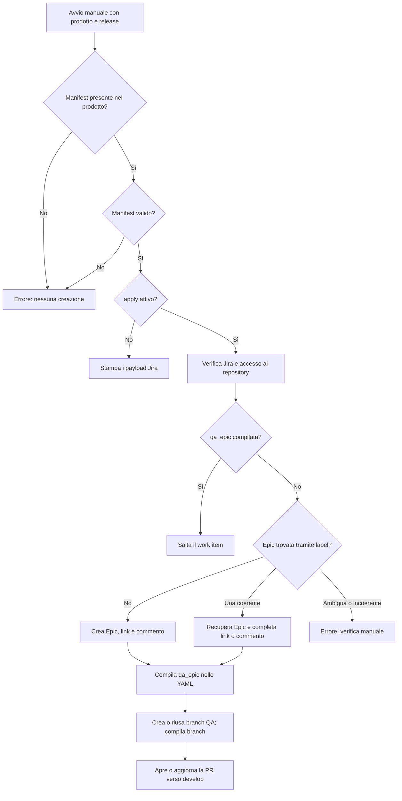

# epic_generator

La GitHub Action manuale `epic_generator` legge il manifest di una release da
`develop` e prepara una QA Epic per ogni work item che non ne ha ancora una.
Collega le Epic ai work item di prodotto, crea i branch QA e propone le chiavi
e i branch nel manifest tramite una PR da revisionare.

## Uso

Da GitHub: **Actions → epic_generator → Run workflow → develop**. Compilare:

| Campo | Esempio | Significato |
| --- | --- | --- |
| `product` | `interop` | Sottocartella di `releases/` |
| `release` | `2.26.0` | Nome del file senza `.yaml` |
| `apply` | Disattivato | Mostra l'anteprima senza creare nulla |

Con `apply` attivato la Action esegue le modifiche in Jira e GitHub. Cerca il
manifest in `releases/<product>/<release>.yaml` (accetta anche `.yml`) e si
ferma se non lo trova. Due prodotti possono avere release con lo stesso nome.

## Manifest e validazione

Il manifest deve avere `release.status: in-progress`, una versione e almeno un
work item. Ogni work item deve avere `id` come chiave Jira e `sequence` come
intero positivo stabile. La coppia `(id, sequence)` deve essere unica nella
release. Ogni work item deve indicare `repo: pn-b2b-client` oppure
`repo: qe_suit`, cioè il repository fisico degli scenari QA. La validazione
avviene prima di qualsiasi chiamata Jira. Una `qa_epic` già
valorizzata viene saltata. La coppia `(id, qa_epic)` valorizzata deve essere
unica nel file. Il campo `branch` non serve alla creazione della QA Epic.

## Funzionamento

Per ciascuna `qa_epic` vuota l'anteprima mostra le richieste Jira previste:
creazione di una `QA Epic` nel progetto QA, collegamento `tests` al work item
di prodotto e commento con la versione della release. Non interroga Jira e
non può quindi conoscere in anticipo la chiave della nuova Epic. Nei payload
di link e commento appare un valore temporaneo come
`<QA_EPIC_KEY_FROM_CREATE_2>`: indica la chiave che Jira restituirà creando
l'Epic per il secondo work item. Se Jira restituisce `QA-19724`, il generatore
usa `QA-19724` per il link e il commento e lo scrive in `qa_epic`.
Il titolo della QA Epic usa `title` del manifest, se presente. Altrimenti usa
il summary della card indicata da `id`, letto da Jira in modalità `apply`;
l'anteprima mostra un segnaposto quando il summary va ancora recuperato.
Il campo Jira Product (`customfield_10648`) vale `INTEROP` per i manifest in
`releases/interop/` e `SEND` per quelli in `releases/send/`.
`size`, se presente, indica giorni uomo come numero positivo (per esempio
`size: 2.5`) e viene inviato a Jira come `timetracking.originalEstimate: 2.5d`.
`fixVersions` usa la versione con nome identico a `release.version` nel progetto
Jira QA. In modalità `apply`, il generatore ne cerca l'ID prima di creare le
Epic e si ferma se la versione non esiste; non crea versioni Jira.
L'issue riceve le label `<version>` e `release-<version>-<id>-<sequence>`;
la seconda è usata dalla modalità `apply` per cercare Epic già create. Se ne
trova una sola, verifica progetto, tipo, label e direzione del link `tests`,
completa link e commento se mancanti e usa la chiave nella stessa PR. In caso
di più risultati o dati incoerenti, si ferma. Il workflow serializza gli avvii
sullo stesso manifest.

## Automazione su `pn-b2b-client`

La Action usa il secret `JIRA_API_TOKEN` e la variabile `JIRA_CLOUD_ID` per
accedere a Jira. Prima di creare le Epic, verifica che la relazione `tests` /
`is tested by` sia disponibile, che la Fix Version esista nel progetto QA e
che tutti i work item siano visibili all'utenza tecnica. Per vedere l'anteprima
anche da terminale, dalla radice del repository:

```bash
python3 -m pip install PyYAML==6.0.3
python3 tools/generators/epic/epic_generator.py releases/interop/2.26.0.yaml
```

Il payload usa Jira REST API v3. Il tipo issue `QA Epic` deve esistere nel
progetto QA. Il nome interno della relazione viene letto dall'istanza Jira.
Con il comando locale `--apply` si aggiornano Jira e il campo `qa_epic` del
file locale; branch e PR vengono creati soltanto dalla Action. Le chiavi
create o recuperate compaiono nei log. La Action
apre o aggiorna una singola PR per manifest usando il token GitHub del workflow;
il repository deve consentire a GitHub Actions di creare pull request. La
Action crea o riusa `feature/<QA-Epic-Key>` nel repository indicato da `repo`,
partendo da `develop`, e propone anche il campo `branch` nella stessa PR.
Per `pn-b2b-client` usa `GITHUB_TOKEN`; per `qe_suit` occorre configurare
`QE_SUIT_TOKEN` come secret con permesso Contents: write su `pagopa/qe_suit`.
I manifest storici con `repo` assente devono essere aggiornati prima di usarli
con questo generatore. La ricerca Jira può non vedere immediatamente una issue
appena creata: dopo un errore, verificare i log e Jira prima del rilancio.

## Flowchart



Il controllo si ripete per ogni work item. La PR non è draft e richiede la
revisione del Principal Lead. Se tutte le `qa_epic` sono già compilate, non
vengono creati branch né aperte PR. Dopo un'interruzione, una Epic già creata
può essere recuperata tramite la label e inserita nella PR al rilancio; un
risultato ambiguo richiede invece una verifica manuale.
